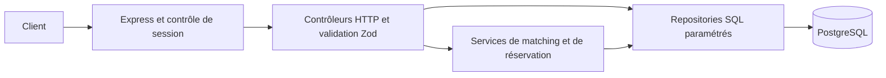

# PlateMate · MVP de matching

Le nouveau backend TypeScript se trouve dans `backend/mvp`. Il utilise son propre schéma PostgreSQL. Le frontend et le service historique conservent leur fonctionnement pendant la migration. Les instructions historiques figurent en deuxième partie.

## Lancement local

### API et PostgreSQL dans Docker

Depuis la racine, utiliser la pile dédiée au MVP. Elle crée un volume PostgreSQL persistant, applique les migrations au démarrage de l’API et publie uniquement le port HTTP sur la boucle locale. Le fichier Compose à la racine concerne l’application historique.

1. Pour une première installation, copier `backend/mvp/.env.example` vers `backend/mvp/.env`. Renseigner `JWT_SECRET` et `MVP_DB_PASSWORD` avec deux valeurs distinctes. Pour générer chacune, utiliser `node -e "console.log(require('node:crypto').randomBytes(32).toString('hex'))"`. Conserver ce fichier local et le même mot de passe tant que le volume est utilisé.
2. Lancer `docker compose -f backend/mvp/compose.yaml up --build -d --wait`.
3. Ouvrir [la santé de l’API locale](http://localhost:3001/health). Pour vérifier un cycle complet de compte depuis l’hôte avec Node 24, lancer `node backend/mvp/test-compose.mjs`. Le script crée puis efface son compte de test.
4. Pour charger les données de démonstration, lancer `docker compose -f backend/mvp/compose.yaml exec api npm run seed`.
5. Pour arrêter les services en conservant les données, lancer `docker compose -f backend/mvp/compose.yaml down`.

### API exécutée sur l’hôte

Le MVP met en relation des personnes selon leurs langues, leurs affinités et leurs contraintes alimentaires. Le backend couvre la découverte, les messages privés, les rencontres, les avis et la gestion du compte. L’intention de paiement est simulée. Le frontend existant utilise encore l’API historique.

Avec Node 24, depuis la racine, lancer `docker compose up -d --wait db` puis `docker compose --profile test up -d --wait db-test`. Dans `backend/mvp`, lancer `npm ci`, copier `.env.example` vers `.env`, définir JWT_SECRET avec un secret aléatoire privé, puis lancer `npm run migrate`, `npm run seed` et `npm start`. Le seed idempotent crée un compte de démonstration sans mot de passe connu. Le port par défaut est 3001. GET /health vérifie la connexion PostgreSQL.

## Tests

Depuis backend/mvp, utiliser npm test pour toute la suite, npm run test:unit, npm run test:integration ou npm run test:security pour une catégorie, et npm run test:coverage pour mesurer les services et utilitaires. Vitest et Supertest utilisent la base platemate_test sur le port 5433. TEST_DATABASE_URL permet de changer de serveur. La préparation recrée le schéma de test par migrations puis nettoie les données entre les cas. Le workflow Matching API applique les seuils de 80 %. Les résultats sont consignés dans chaque commit de sprint. Les tests de charge, E2E navigateur et audits externes restent hors périmètre.

## Architecture et limites



| Sprint | Stories | Parcours et code dans backend/mvp |
|---|---|---|
| S0 | Socle | src/app.ts, src/migrations.ts, sql, test |
| S1 | US01–02 | routes/auth.ts, services/auth.ts, sessions |
| S2 | US03–05, US15 | services/profile.ts, consentement, édition du profil privé |
| S3 | US06–09 | services/scoring.ts, repositories/explorer.ts |
| S4 | US10–14 | controllers/host.ts, repositories/social.ts, avis et badges |
| S5 | US16–17 | services/booking.ts, repositories/bookings.ts, historique et intention simulée |
| Compléments après S5 | US10–11, US14–15 | Messagerie, avis, export personnel et effacement, après dessin des parcours |
| Post-MVP | US18 | Stripe Connect |

**Confidentialité.** Les hashes d’authentification, le nom complet et les contraintes sensibles sont exclus des profils publics. Seuls les intérêts que les deux personnes ont rendus publics peuvent être nommés. L’export porte sur les données détenues ou créées par l’appelant. Le compte et les données qui lui sont rattachées sont supprimés en base par une transaction avec cascades.

**Résultats locaux.** 87 tests sur 87 réussis. Sur les services et la configuration, 64/65 lignes, 70/71 instructions, 32/33 branches et 26/26 fonctions. Le scoring et la machine à états sont couverts à 100 %. Les migrations, deux exécutions successives du seed et une requête HTTP réelle sur /health ont été vérifiées sur la base dédiée.

**Hypothèses et limites.** La proposition de parcours complémentaires est écartée. Les références manquantes doivent être demandées à l’équipe produit. L’adresse exacte du domicile reste exclue du modèle. Le vocabulaire des contraintes est normalisé par casse et espaces, mais deux synonymes distincts ne sont pas assimilés. Une capacité alimentaire inconnue exclut le contexte. Les filtres SQL réduisent le jeu de candidats avant le tri en mémoire. Les gros volumes, la rétention des sauvegardes et les notifications restent à traiter avant une mise en production. Le rapport distingue services, contrôleurs et repositories.

Contrôle de mutation S1 effectué sur PostgreSQL. Après retrait du contrôle de présence de la session, « US01 / SANS ÉCRAN déconnexion : access et refresh révoqués » a reçu 200 au lieu de 401 sur GET /me. Le contrôle a été rétabli et la suite complète relancée. Les mutations scoring, allergies et réservations relèvent des futurs sprints.

La connexion utilise bcrypt (coût 12), un JWT HS256 de dix minutes et un refresh opaque dont seule l’empreinte est conservée en base. Le cookie HttpOnly, SameSite=Strict et Secure en production limite l’accès au refresh. Le frontend doit conserver l’access token en mémoire. La session a une durée absolue de sept jours. La limitation des essais est locale au processus Express et suppose une instance unique. Voir [le contrat HTTP](docs/api.md).

Express assure le transport HTTP, PostgreSQL impose les contraintes persistantes et les migrations SQL versionnées sont transactionnelles. Le schéma séparé évite de réinterpréter les réservations commerciales existantes. La suite locale couvre les nouveaux contrats uniquement. Voir [le schéma](docs/schema-mvp.md), [les critères](docs/backlog.md) et [la traçabilité](docs/traceability.md).

### Matching du MVP et tests de mutation S3

Après exclusion des contextes dont les capacités déclarées ne couvrent pas chaque allergie et intolérance du visiteur, le score arrondi vaut 40 × fraction des langues communes + 40 × fraction des affinités communes + 20 × fraction des régimes pris en charge. Chaque fraction utilise le nombre de critères du visiteur comme dénominateur et vaut zéro si ce nombre est nul. Pour un visiteur parlant français et anglais, aimant jazz et cinéma et suivant un régime végan, les cinq exemples testés sont : tout commun = 100 ; une langue, une affinité et le régime = 60 ; les deux langues seules = 40 ; les deux affinités seules = 40 ; rien de commun = 0. Chaque repas compatible a sa propre carte. Les langues et les thèmes sont déclarés pour ce repas. Les critères non renseignés rapportent zéro point. Les pondérations 40/40/20 sont provisoires. Les identifiants départagent les ex æquo.

Contrôles manuels. Mettre à zéro le poids des langues a fait échouer quatre tests US06. Inverser le contrôle des allergènes a fait échouer « un score maximal ne neutralise jamais une incompatibilité ». Les deux mutations ont été annulées.
### Réservations et mutations S5

La mutation autorisant completed → pending a été détectée par le test de cette transition. Inverser la condition qui réserve les décisions à l’hôte a fait échouer le scénario HTTP US16. Les deux mutations ont été annulées. Le paiement simulé ne déclenche aucun mouvement de fonds.

## Application historique


PlateMate met les expériences culinaires au centre. Les visiteurs découvrent le menu et l'hôte (photo, présentation, langues, centres d'intérêt), puis filtrent par cuisine, thème, ambiance, ville, date, régime et nombre de places. Le questionnaire peut alimenter ces filtres ; il n'y a pas de score de compatibilité. Voir le [périmètre fonctionnel du backend](backend/FONCTIONNALITES.md).

## Démarrer avec Docker

Installer Docker avec le plugin Compose, puis lancer ces commandes **depuis la racine du dépôt** :

```sh
docker compose up --build -d --wait
```

Compose construit le frontend React et l'API, démarre PostgreSQL et le worker, puis applique les migrations avant de servir l'API. L'attente `--wait` vérifie les services dotés d'un healthcheck. Le premier build peut prendre plusieurs minutes.

| Adresse locale | Fonction |
|---|---|
| [localhost:8080](http://localhost:8080/) | Communauté WhatsApp (`/` et `/whatsapp/`) |
| [localhost:3000/api/ready](http://localhost:3000/api/ready) | API et connexion à PostgreSQL |
| `localhost:5432` | PostgreSQL, accessible uniquement depuis cette machine |

Le frontend public ne présente pas encore les écrans de réservation. Pour tester le parcours API après démarrage :

```sh
cd backend
npm ci
npm run demo
cd ..
```

Les comptes et réservations créés par la démo restent dans la base locale. Les commandes courantes, depuis la racine :

```sh
docker compose ps                      # état des services
docker compose logs -f api frontend    # logs en direct (Ctrl+C quitte les logs)
docker compose up --build -d --wait    # reconstruire après une modification
docker compose down                    # arrêter en conservant les données
docker compose down -v                 # réinitialiser aussi la base et les médias locaux
```

`down -v` efface les volumes Docker `pgdata` et `media` : l'utiliser uniquement pour repartir de zéro. En cas de port 3000, 5432 ou 8080 déjà utilisé, libérer ce port avant le démarrage.

Le mode par défaut est `AUTH_MODE=local`. Stripe reste limité aux clés de test ; sans clé, le paiement est indisponible. Pour tester Checkout et les webhooks, renseigner `STRIPE_SECRET_KEY=sk_test_...`, `STRIPE_WEBHOOK_SECRET` et `STRIPE_CONNECT_WEBHOOK_SECRET` dans un fichier `.env` **à la racine**, puis recréer les services API et worker avec `docker compose up --build -d --wait`. La CLI Stripe tourne sur la machine hôte. Voir le [guide backend](backend/README.md) pour la procédure de paiement test. Ne pas versionner `.env`.

## Frontend

Le frontend React, TypeScript et Vite sert la communauté WhatsApp sur `/` et `/whatsapp/`, puis l'équipe et les mentions légales. La page indique « Site en construction ». Vercel construit et publie `frontend/dist`.

```sh
cd frontend
npm ci
npm run start
```

Cette commande démarre le serveur de développement Vite sur `http://localhost:8080` et recharge les modifications React/SCSS. Si Docker tourne déjà, arrêter son frontend avec `docker compose stop frontend` depuis la racine pour libérer le port 8080. Docker sert le build compilé et ne recharge pas le code en direct. Voir le [guide frontend](frontend/README.md) pour les routes, le SCSS et le build statique. Les parcours Auth0, réservation et paiement ne sont pas encore reliés à l'interface.

## Backend sans Docker Compose complet

Le [guide backend](backend/README.md) contient les commandes d'installation, les tests PostgreSQL, le parcours Stripe test, Auth0 et les conditions de déploiement. Le [catalogue fonctionnel](backend/FONCTIONNALITES.md) sépare les fonctions codées des fonctions prévues.

```sh
docker compose up -d --wait db
cd backend
npm ci
cp .env.example .env
npm run migrate
npm run dev
# puis dans un autre terminal : npm run demo
```

Le backend est réservé aux essais avec Stripe en mode test. Le détail des fonctions et des limites est dans le [catalogue fonctionnel](backend/FONCTIONNALITES.md).
