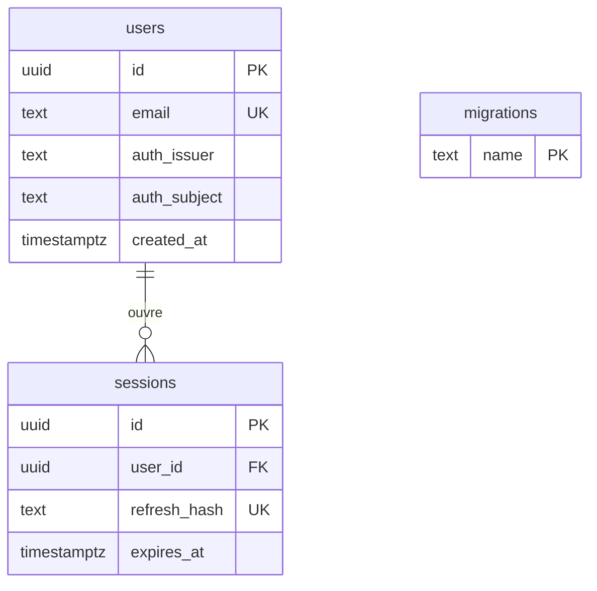
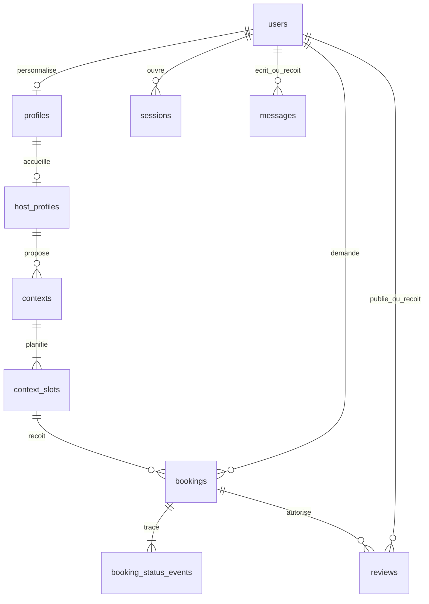

# Schéma physique S0

Le schéma PostgreSQL platemate_mvp isole ces tables du backend historique. migrations sert au déploiement sans écran utilisateur. Les tables des sprints suivants figurent comme propositions dans traceability.md.
## Modèle après S5

Les colonnes physiques et leurs contraintes sont définies par les sept migrations de backend/mvp/sql. Les deux membres d’un échange sont identifiés par sender_id et recipient_id. Un événement de réservation conserve son acteur et son horodatage. Le profil validé est stocké dans details en JSONB pour être remplacé atomiquement. Le badge et la date du consentement restent séparés du document modifiable par le propriétaire.
