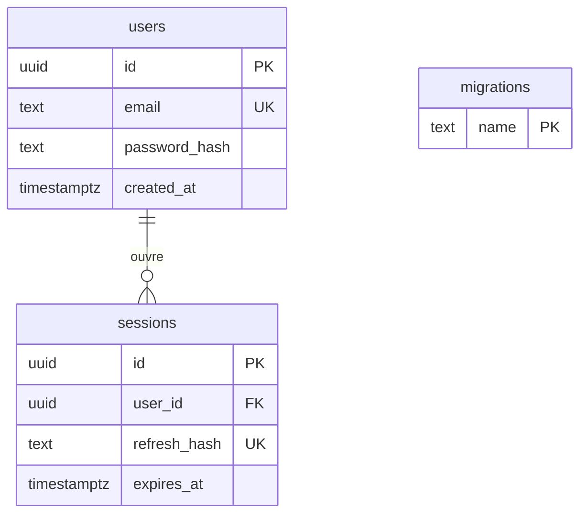

# Schéma physique S0

Le schéma PostgreSQL platemate_mvp isole ces tables du backend historique. migrations sert au déploiement sans écran utilisateur. Les tables des sprints suivants figurent comme propositions dans traceability.md.
